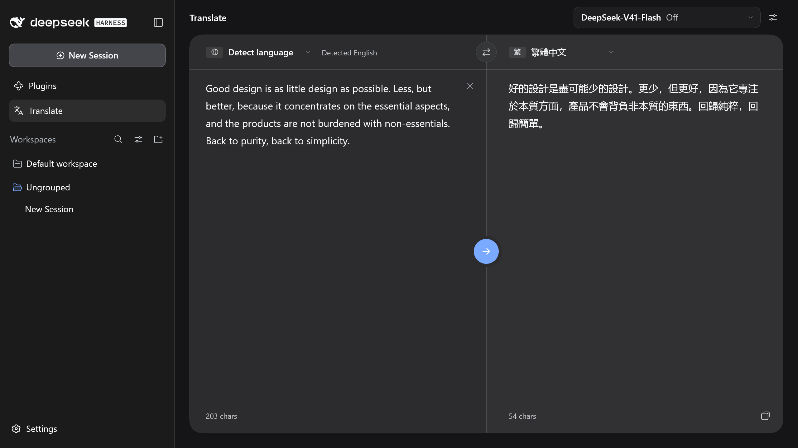

<div align="center">

# 🌐 dsh-translate-tab

**DeepSeek Harness 的翻譯插件。**

[](../package.json) [](../LICENSE) [](#-安裝) [](#語言) [](#-架構) [](https://dsh-plugin.org/plugins/zhen-bo/dsh-translate-tab)

[安裝](#-安裝) · [快速開始](#-快速開始) · [使用說明](#-使用說明) · [疑難排解](#-疑難排解)

[English](../README.md) | 繁體中文

</div>



## ✨ 功能

- **側邊欄整合**：在「插件」下新增「翻譯」入口，於主區域開啟雙欄翻譯介面。
- **共用模型清單**：使用與 Harness 對話相同的供應商與模型，可調整思考強度。
- **低延遲預設**：預設採用清單中的預設模型，並關閉思考。
- **15 種語言**：支援自動偵測來源語言。
- **可自訂提示詞**：支援 `{{target_language}}`、`{{source_language}}`、`{{text}}` 變數。
- **介面在地化**：跟隨 Harness 語言設定，提供英文、簡體中文與繁體中文介面。

## 📋 需求

- DeepSeek Harness 桌面版，且 `dsh` CLI 已加入 `PATH`
- 「設定 › 模型」中至少有一個已設定有效 API 金鑰的模型

## 📦 安裝

### 從 DSH Plugin Hub 安裝

1. 安裝 DSH Plugin Hub：

   ```bash
   dsh plugin --profile desktop add dsh-plugin
   ```

2. 重新啟動 DeepSeek Harness。
3. 開啟「**設定 › 插件市場**」，搜尋 `dsh-translate-tab` 並選擇「**安裝**」。

### 從 GitHub 安裝

1. 從儲存庫安裝插件：

   ```bash
   dsh plugin --profile desktop add "github:Zhen-Bo/dsh-translate-tab"
   ```

2. 重新啟動 DeepSeek Harness。

## 🚀 快速開始

1. 在側邊欄開啟「**插件 › 翻譯**」。
2. 在左欄輸入原文。
3. 按 <kbd>Ctrl</kbd> + <kbd>Enter</kbd>，macOS 為 <kbd>⌘</kbd> + <kbd>Enter</kbd>。

譯文以串流方式輸出至右欄。

## 🧭 使用說明

### 語言

繁體中文、简体中文、English、日本語、한국어、Français、Deutsch、Español、Português、Italiano、Русский、Tiếng Việt、ไทย、Bahasa Indonesia、العربية，皆可作為來源或目標語言。

自動偵測適用於來源語言，可辨識日文、韓文、阿拉伯文、泰文、俄文、簡體中文、繁體中文與英文。

### 模型與思考強度

模型選單位於右上角，思考強度由模型清單下方的滑桿設定。

### 翻譯提示詞

提示詞編輯器由模型選單旁的按鈕開啟。提示詞以使用者訊息送出，並替換以下變數：

| 變數 | 值 |
|---|---|
| `{{target_language}}` | 目標語言的英文名稱，例如 `Japanese` |
| `{{source_language}}` | 來源語言名稱，或 `the detected source language` |
| `{{text}}` | 原文。提示詞未包含此變數時，原文附加於結尾 |

### 資料儲存

| 資料 | 位置 | 保存期間 |
|---|---|---|
| 語言、模型、思考強度與自訂提示詞 | `localStorage` 的 `dsh-translate-tab:v1` | 持續保存 |
| 原文草稿 | `sessionStorage` 的 `dsh-translate-tab:draft` | 目前視窗工作階段 |

## 🔧 疑難排解

| 訊息 | 處理方式 |
|---|---|
| 這個模型還沒有設定 API 金鑰 | 在「設定 › 模型」加入金鑰，或改選其他模型 |
| 金鑰無效或沒有權限 | 在「設定 › 模型」確認金鑰 |
| 請求太頻繁 | 稍候再重試 |
| 回應中途斷掉了 | 重新執行翻譯 |
| 文字太長 | 將原文分段，每段少於 100,000 字元 |

若「插件」下未出現「翻譯」，請確認安裝路徑並重新啟動 DeepSeek Harness。

## 🧹 解除安裝

```bash
dsh plugin --profile desktop remove dsh-translate-tab
```

完成後重新啟動 DeepSeek Harness。

## 🧩 架構

| 路徑 | 執行環境 | 用途 |
|---|---|---|
| `src/client` | Harness 視窗 | 翻譯頁面，以 React 與 TypeScript 撰寫 |
| `src/server` | Harness 主程式 | `POST /translate/api/stream`，串流單次模型呼叫 |
| `src/shared` | 兩者 | 路由、文字長度上限與串流事件型別 |
| `locale` | Harness 視窗 | 介面文字，註冊至 Harness 語系服務 |
| `lib` | 兩者 | Harness 載入的建置產物 |

<details>
<summary>串流格式</summary>

<br>

此路由接受來自 Harness 視窗的同源請求，回應格式為逐行 JSON：

```text
{"t":"text","v":"..."}        譯文片段
{"t":"done"}                  完成
{"t":"aborted"}               已取消
{"t":"error","message":"..."} 失敗
```

</details>

## 💻 開發

1. 安裝相依套件，並將工作目錄連結至 desktop profile：

   ```bash
   npm install
   dsh plugin --profile desktop add "link:D:/path/to/dsh-translate-tab"
   ```

2. 以監看模式執行建置，重新啟動 DeepSeek Harness 後載入修改：

   ```bash
   npm run dev
   ```

| 指令 | 用途 |
|---|---|
| `npm run build` | 建置 `lib/client.js` 與 `lib/index.js` |
| `npm run check` | 執行型別檢查、lint、測試與建置 |
| `npm run fix` | 以 gts 格式化程式碼 |

## 📄 授權

採用 [MIT 授權條款](../LICENSE)。
